# Travel Translator AI


An Android-first AI travel translator built to make face-to-face communication feel closer to a conversation than a dictionary. Type or speak, get a streaming translation, hear it aloud, and keep the phrases and conversations you use most.

**Live API:** <https://travel-translator-api.vercel.app> · **API docs:** <https://travel-translator-api.vercel.app/api/docs> · **UI reference:** <https://travel-translator-web.vercel.app>

> **Status:** Android is functional and has been installed on a physical device. The FastAPI backend is deployed on Vercel with Neon Postgres. The iOS app is still a SwiftUI design-system shell, and the web app is a visual reference prototype — see [Current status](#current-status).

---

## Screenshots

The first image is a real Android device capture. The rest are from the Vite design reference used to build the native UI.

<table>
  <tr>
    <td align="center">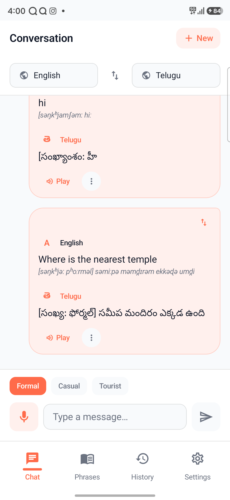<br><sub><b>Android app — live chat</b></sub></td>
    <td align="center">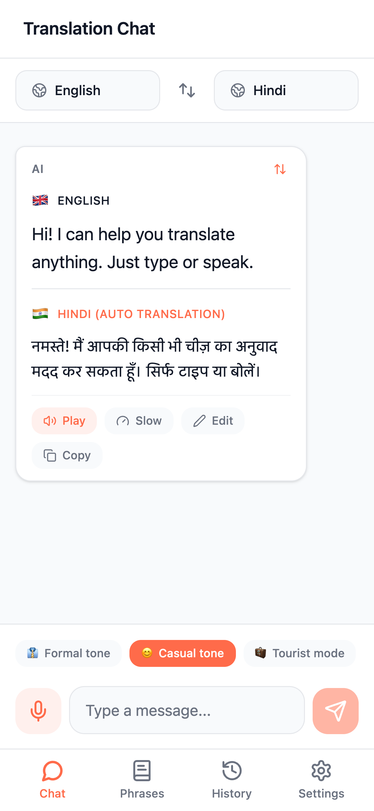<br><sub>Chat + translation</sub></td>
    <td align="center">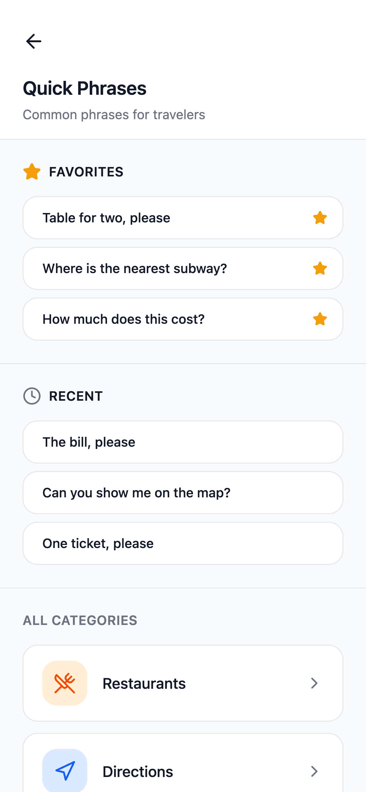<br><sub>Quick Phrases</sub></td>
  </tr>
  <tr>
    <td align="center">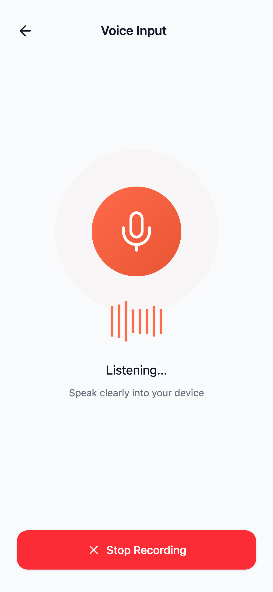<br><sub>Voice input</sub></td>
    <td align="center">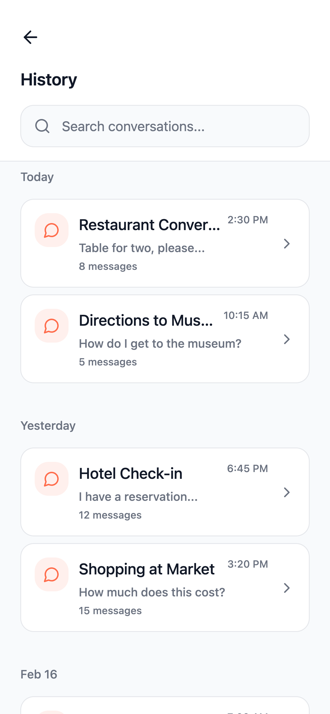<br><sub>History</sub></td>
    <td align="center">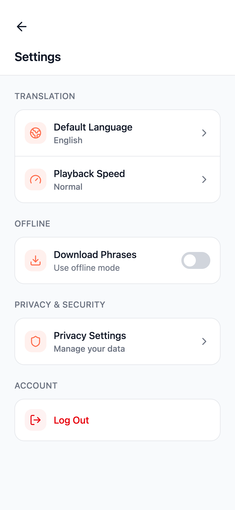<br><sub>Settings</sub></td>
  </tr>
  <tr>
    <td align="center">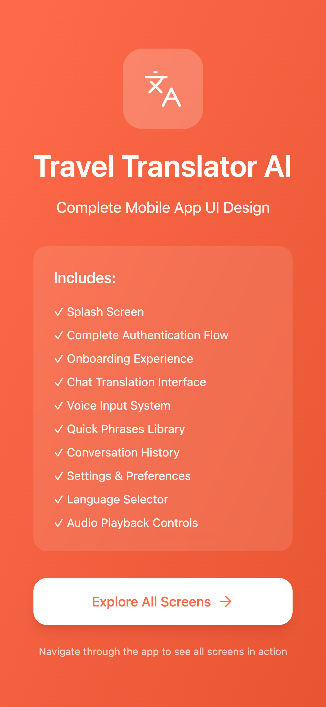<br><sub>Welcome</sub></td>
    <td align="center">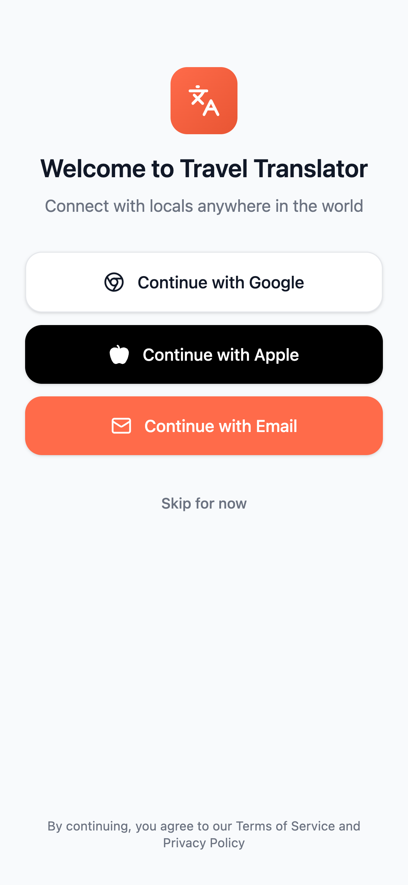<br><sub>Sign in</sub></td>
    <td align="center">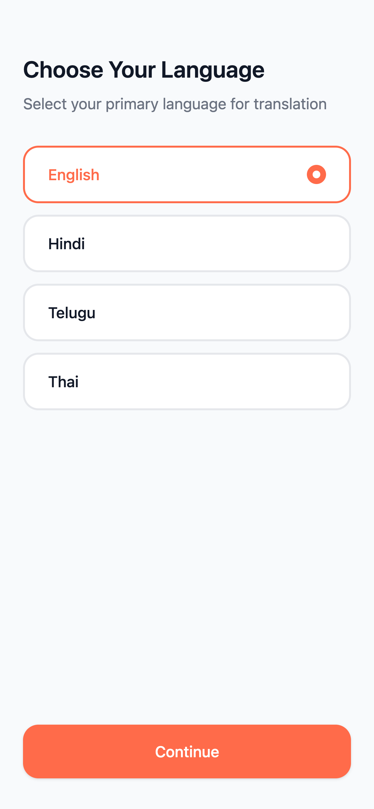<br><sub>Onboarding</sub></td>
  </tr>
</table>

### Onboarding & permissions

<table>
  <tr>
    <td align="center">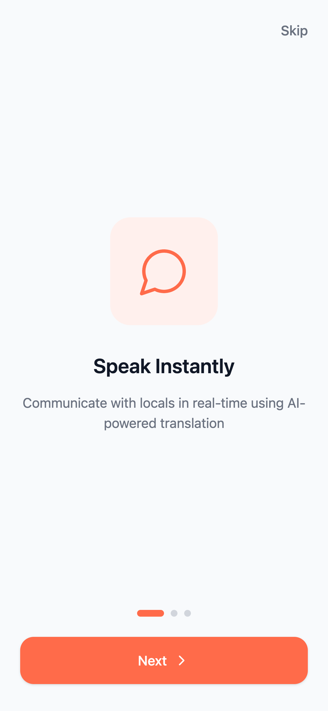<br><sub>Onboarding</sub></td>
    <td align="center">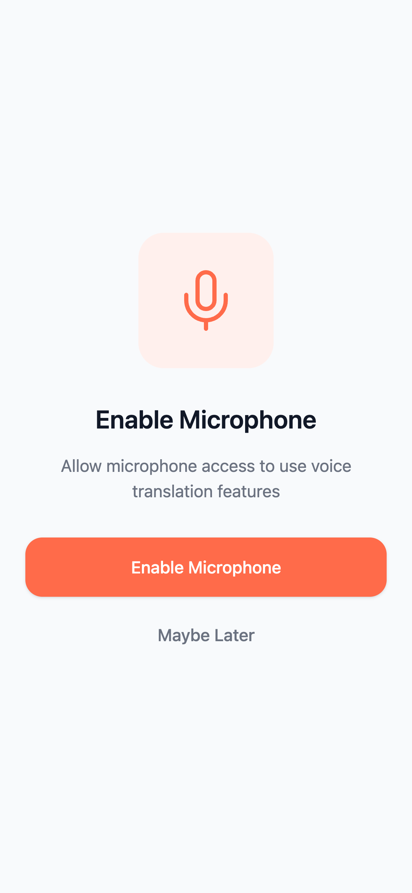<br><sub>Microphone permission</sub></td>
  </tr>
</table>

---

## What it does

- **20 languages** with source/target selection and same-language prevention
- **Streaming translation** over Server-Sent Events, rendered token-by-token
- **Context-aware prompts** with Formal / Casual / Tourist modes
- **Speech-to-text** using Whisper
- **Text-to-speech** with normal and slow playback; on-device fallback for languages without a server voice
- **IPA pronunciation guides** for non-Latin scripts
- **Quick Phrases** across six categories, with search, favorites, and recents — all API-driven
- **Conversation history** with search, restore, and delete/undo
- **Settings** for default language, playback speed, and offline packs
- **Offline translation** via ML Kit when the backend is unreachable
- **Guest mode**, email/password auth, and Google sign-in through Firebase

## Tech stack

| Layer | What is used |
| --- | --- |
| **Android** | Kotlin 2.0.21, Jetpack Compose (BOM 2024.10.01), Material 3, Navigation Compose, Hilt 2.52, MVVM + StateFlow, Retrofit 2.11, OkHttp 4.12, Kotlin Serialization 1.7.3, DataStore, Firebase Auth, ML Kit Translate, Java 17, minSdk 26 / targetSdk 35 |
| **Backend** | Python 3.12 on Vercel, FastAPI, Pydantic v2, SQLAlchemy 2 async, asyncpg, Alembic, httpx, Firebase Admin, python-jose, `uv`, `epitran`, `soundfile` |
| **Database** | PostgreSQL on Neon (serverless, Singapore region), schema managed by Alembic |
| **Translation** | Groq `openai/gpt-oss-120b`; HF router `meta-llama/Llama-3.3-70B-Instruct` fallback |
| **Speech-to-text** | Groq `whisper-large-v3-turbo`; HF `openai/whisper-large-v3` fallback |
| **Text-to-speech** | HF router → Replicate `resemble-ai/chatterbox-turbo` (English/Hindi); Android `TextToSpeech` for other languages |
| **Pronunciation** | `epitran` for Hindi, Telugu, Tamil, Bengali, Marathi, Thai, Korean, Russian |
| **Web reference** | Vite 6, React 18, TypeScript, MUI 7, Tailwind 4, Radix UI |
| **iOS** | SwiftUI, Swift 6, iOS 17 target — design system only |
| **CI** | GitHub Actions for backend tests, Android unit tests, and iOS build |

## Architecture

```text
┌──────────────────────────────┐
│  Android app                 │
│  Kotlin + Compose + Hilt     │
│  Retrofit/OkHttp + SSE       │
└──────────────┬───────────────┘
               │ HTTPS + Bearer JWT
               ▼
┌──────────────────────────────┐        ┌─────────────────────────────┐
│  FastAPI on Vercel           │───────►│  Groq                       │
│  app/main.py + routers/*     │        │  gpt-oss-120b (translate)   │
│  services/*                  │        │  whisper-large-v3-turbo    │
│  Pydantic + SQLAlchemy async│        └─────────────────────────────┘
└──────────────┬───────────────┘
               │                        ┌─────────────────────────────┐
               ├───────────────────────►│  Hugging Face router        │
               │                        │  Llama fallback + Whisper   │
               │                        │  Replicate TTS              │
               │                        └─────────────────────────────┘
               ▼
┌──────────────────────────────┐
│  Neon Postgres               │
│  users · settings            │
│  conversations · messages    │
│  languages · phrases         │
│  phrase_translations         │
│  favorites · recents         │
└──────────────────────────────┘
```

**Auth flow:** Firebase ID token → `/api/v1/auth/verify` → short-lived app JWT. Guest users call `/api/v1/auth/guest` and get a JWT without Firebase.

**Translation flow:** `/translate` or `/translate/stream` → provider selection (Groq by default, HF fallback) → idiomatic translation prompt → optional `epitran` IPA → recents write → JSON/SSE response.

## API surface

All routes are under `/api/v1` except the health check.

| Route | Purpose |
| --- | --- |
| `POST /auth/guest` | Create a guest account and JWT |
| `POST /auth/verify` | Verify Firebase ID token, return app JWT |
| `GET /me`, `DELETE /me` | Profile / account deletion |
| `POST /translate` | Translate text |
| `POST /translate/stream` | Streaming translation (SSE) |
| `POST /translate/batch` | Translate up to 50 strings |
| `POST /stt/transcribe` | Whisper speech-to-text |
| `POST /tts/synthesize` | Server TTS for English/Hindi |
| `GET /languages` | Language catalog with capability flags |
| `GET /phrases/categories` | Phrase categories |
| `GET /phrases?category=…&target=…` | Translated phrases with pronunciation |
| `GET/POST /conversations` | List/create conversations |
| `GET/DELETE /conversations/{id}` | Conversation detail / delete |
| `POST /conversations/{id}/messages` | Append a message |
| `GET/POST/DELETE /favorites` | Phrase favorites |
| `GET /recents` | Recently translated phrases |
| `GET/PATCH /settings` | User preferences |
| `GET /health`, `GET /api/health` | Health check |

## Project structure

```text
.
├── android/                 # Kotlin + Jetpack Compose app
│   └── app/src/main/java/com/divami/traveltranslator/
│       ├── core/            # network, Firebase bootstrap, safe API calls
│       ├── data/            # DTOs, repositories, DataStore, ML Kit fallback
│       ├── domain/model/    # Language, Translation, Conversation, ...
│       ├── designsystem/    # generated tokens, theme, components
│       ├── feature/         # auth, onboarding, chat, voice, phrases, history, settings
│       └── nav/             # type-safe Compose routes
├── backend/                 # FastAPI service
│   ├── app/main.py          # app + router registration
│   ├── app/routers/         # auth, translate, stt, tts, phrases, ...
│   ├── app/services/        # provider clients + prompt logic
│   ├── app/db/models/       # SQLAlchemy models
│   ├── alembic/             # migrations
│   └── scripts/             # seed languages/phrases
├── ios/                     # SwiftUI design-system shell
├── reference_app/           # Vite/React design reference (not production)
├── shared/design-tokens.json
├── tools/gen-tokens.mjs     # design-token codegen
└── docs/screenshots/
```

## Getting started

### Backend

```bash
cd backend
cp .env.example .env          # fill in the required values
uv sync
docker compose up -d db       # local Postgres
uv run alembic upgrade head
uv run python -m scripts.seed_phrases
uv run uvicorn app.main:app --reload --port 8123
```

Health check: <http://localhost:8123/health>  
API docs: <http://localhost:8123/docs>

Required environment variables include:

```text
DATABASE_URL
APP_JWT_SECRET
FIREBASE_PROJECT_ID
FIREBASE_SERVICE_ACCOUNT_JSON
GROQ_API_KEY
HF_API_TOKEN
CORS_ALLOWED_ORIGINS
MAX_AUDIO_BYTES
```

### Android

```bash
# android/local.properties (gitignored)
BACKEND_BASE_URL=https://travel-translator-api.vercel.app

cd android
./gradlew assembleDebug
adb install -r app/build/outputs/apk/debug/app-debug.apk
```

`local.properties` also holds Firebase client values and release-signing credentials; it is intentionally not committed.

### Web reference

```bash
cd reference_app
npm install
npm run dev
```

### iOS

Open `ios/TravelTranslator.xcodeproj` in Xcode 16. The current iOS target contains the design system and component gallery only; feature screens are not implemented yet.

## Deployment

| Service | Platform | Notes |
| --- | --- | --- |
| API | Vercel Python function | Root `backend`, FastAPI preset, Python 3.12, region `sin1` |
| Database | Neon Postgres | Provisioned through Vercel Marketplace; migrations + seed applied |
| Web reference | Vercel static | `reference_app` Vite build |
| Android | Local/Play build | Debug APK currently installed on a physical Samsung device |

The API is deployed from the `backend` directory. Vercel supplies `DATABASE_URL` automatically through the Neon integration; the rest of the production values are set as project environment variables.

## Testing

```bash
# Backend
cd backend
uv run pytest
uv run ruff check .
uv run black --check .
uv run mypy app

# Android
cd android
./gradlew testDebugUnitTest
./gradlew assembleDebug
```

CI workflows live in `.github/workflows/` and cover backend tests, Android unit tests, and the iOS build.

## Design tokens

`shared/design-tokens.json` is the single source of truth for color, spacing, radius, and typography. `tools/gen-tokens.mjs` generates `Tokens.kt` and `Tokens.swift`; the Android Gradle build runs the generator automatically. Avoid hardcoding brand colors in feature code.

## Current status & known limitations

- **Android:** functional; installed and smoke-tested on a physical Samsung device.
- **Backend:** deployed and verified for auth, translation, streaming, batch, STT, phrases, favorites, recents, conversations, and settings.
- **iOS:** design-system shell only; no feature screens yet.
- **Web reference:** static UI prototype with mock data; not wired to the live API.
- **Server TTS:** the Replicate/HF account currently has no credits, so `/tts/synthesize` returns `502`. The Android client falls back to on-device TTS.
- **Slow TTS:** `librosa` was removed from the Vercel bundle to stay under the 500 MB function limit, so server-side “slow” playback serves normal-speed audio. On-device TTS still supports slow speech.
- **Cold starts:** Neon free tier and Vercel serverless functions can add latency after idle periods. Phrase translations are cached in Postgres after first use.

## AI-assisted development

This project was built with AI coding assistants as implementation partners — scaffolding, DTOs, repositories, routers, tests, and deployment debugging. Architecture, API contracts, data model, security decisions, and release verification were owned and reviewed by the developer. The most useful pattern was a tight verification loop: compile, unit tests, real API calls, and a physical-device install.
